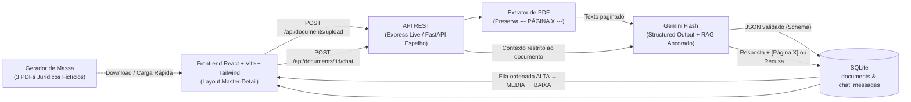

# JurisTriage — Triagem Inteligente de Documentos Jurídicos & RAG

[](./LICENSE)

MVP Full Stack enxuto, modular e auditável para **ingestão de PDFs jurídicos, classificação estruturada via LLM (Gemini Flash), priorização por urgência em SQLite e chat RAG ancorado por página** com trava explícita anti-alucinação.

Projetado com arquitetura limpa e rastreabilidade ponta a ponta para fluxos reais de controladoria jurídica — suportando desde intimações judiciais críticas com número CNJ até contratos comerciais extrajudiciais sem CNJ.

---

## Arquitetura do Sistema



---

## Funcionalidades Principais

- **Ingestão Genérica de PDF com Rastreabilidade de Página:** Valida assinatura `%PDF-` e extrai texto página por página inserindo marcadores explícitos (`--- PÁGINA X ---`).
- **Extração Estruturada via Schema:** Classifica qualquer peça (intimação, petição inicial ou contrato sem número CNJ) nos campos:
  - `tipo_documento`
  - `numero_processo` *(opcional/nulo para contratos e extrajudiciais)*
  - `partes_envolvidas`
  - `prazo_ou_vigencia`
  - `valor_envolvido`
  - `urgencia` (`ALTA`, `MEDIA`, `BAIXA`)
  - `resumo_executivo`
- **Fila Priorizada em SQLite:** Persiste documentos e histórico de conversas em banco relacional local com consultas parametrizadas e ordenação automática por severidade (`ALTA` > `MEDIA` > `BAIXA`).
- **Chat RAG Estritamente Ancorado:** Responde exclusivamente com base nas páginas extraídas do documento selecionado, retorna citações clicáveis (`Ver Página X`) que levam ao trecho exato no auditor paginado e recusa responder perguntas sem lastro textual.
- **Massa de Teste Realista (3 PDFs):** Inclui geração sob demanda no aplicativo (download individual ou carga rápida em 1 clique) e script `fpdf2` em `scripts/generate_sample_pdfs.py`.

---

## Estrutura Modular do Repositório

```text
.
├── backend/                     # Módulo Python/FastAPI equivalente (execução local Ubuntu)
│   ├── schemas.py               # Contratos Pydantic v2 (extração + RAG)
│   ├── extractor.py             # Parser pypdf com marcadores --- PÁGINA X ---
│   ├── llm_service.py           # Cliente google-genai (Gemini Flash)
│   ├── models.py                # Modelos SQLAlchemy + SQLite
│   ├── main.py                  # Endpoints FastAPI
│   └── requirements.txt         # Dependências Python
├── scripts/
│   └── generate_sample_pdfs.py  # Gerador fpdf2 dos 3 PDFs jurídicos fictícios
├── server/                      # Camada Node/Express da demonstração live
│   ├── db.ts                    # SQLite (better-sqlite3) parametrizado
│   ├── pdfExtractor.ts          # Extrator paginado (unpdf)
│   ├── llmService.ts            # Cliente @google/genai (Gemini Flash)
│   └── sampleGenerator.ts       # Gerador dinâmico de PDFs (pdf-lib)
├── src/                         # Front-end React + Vite + Tailwind CSS
│   ├── components/              # TopBar, DocumentQueue, DocumentDetail, DemoKit, Architecture
│   ├── lib/api.ts               # Cliente HTTP tipado
│   └── App.tsx                  # Orquestração Master-Detail
├── server.ts                    # Entrypoint Full Stack (Express + Vite middleware)
├── .env.example                 # Variáveis de ambiente (sem segredos)
├── .gitignore                   # Bloqueio rigoroso (.env, *.db, venv, __pycache__, node_modules)
└── LICENSE                      # MIT License (2026, Miguel Rabelo Wagner)
```

---

## Como Executar

### 1. Aplicação Full Stack Live (React + Node/Express + SQLite)

```bash
cp .env.example .env
# Preencha GEMINI_API_KEY no arquivo .env

npm install
npm run dev
```

Acesse `http://localhost:3000`.

### 2. Módulo Python / FastAPI + Gerador `fpdf2` (Ubuntu)

```bash
python3 -m venv venv
source venv/bin/activate
pip install -r backend/requirements.txt

cp .env.example .env
# Preencha GOOGLE_API_KEY no arquivo .env

# Gerar os 3 PDFs jurídicos fictícios em samples_output/
python scripts/generate_sample_pdfs.py

# Subir a API FastAPI
uvicorn backend.main:app --reload --port 8000
```

Documentação interativa OpenAPI disponível em `http://localhost:8000/docs`.

---

## Endpoints da API

| Método | Rota | Descrição |
| :--- | :--- | :--- |
| `GET` | `/api/health` | Verificação de disponibilidade da API |
| `GET` | `/api/documents` | Lista documentos ordenados por urgência (`ALTA` → `MEDIA` → `BAIXA`) |
| `POST` | `/api/documents/upload` | Ingestão multipart de PDF, extração paginada, triagem IA e persistência |
| `GET` | `/api/documents/:id` | Retorna ficha estruturada, texto paginado e histórico do chat |
| `DELETE` | `/api/documents/:id` | Remove documento e mensagens vinculadas em cascata |
| `POST` | `/api/documents/:id/chat` | Consulta RAG ancorada no documento com citações de página |
| `GET` | `/api/samples/:slug/pdf` | Download de cada um dos 3 PDFs jurídicos fictícios *(servidor live)* |
| `POST` | `/api/samples/load` | Carga rápida de demonstração pelo pipeline real *(servidor live)* |

---

## Fluxo Git & Conventional Commits (`MRWhub`)

```bash
git init -b main
git add .gitignore .env.example LICENSE
git commit -m "chore: inicializar estrutura modular, .gitignore rigoroso e licença MIT"
git checkout -b develop

git add scripts/generate_sample_pdfs.py
git commit -m "feat(data): adicionar gerador fpdf2 com 3 PDFs jurídicos fictícios"

git add backend/schemas.py backend/extractor.py backend/llm_service.py
git commit -m "feat(ai): implementar extrator paginado pypdf e triagem/RAG via Gemini Flash"

git add backend/models.py backend/main.py backend/requirements.txt
git commit -m "feat(api): criar endpoints FastAPI com persistência SQLite e SQLAlchemy"

git add src/ server.ts server/ index.html package.json
git commit -m "feat(ui): construir interface Master-Detail editorial com chat RAG clicável"

git add README.md
git commit -m "docs: adicionar README técnico com diagrama Mermaid e guia de execução"

git checkout main && git merge --no-ff develop -m "chore: consolidar MVP JurisTriage v1.0 na main"
git push -u origin main develop
```

---

## Segurança & Boas Práticas

- Chaves de API (`GEMINI_API_KEY` / `GOOGLE_API_KEY`) residem exclusivamente no servidor via `.env` (bloqueado pelo `.gitignore`), sem exposição no front-end.
- Todas as operações em SQLite utilizam consultas parametrizadas (*prepared statements* / ORM SQLAlchemy).
- Validação de extensão, tipo MIME, assinatura binária `%PDF-` e limite de 10 MB em memória nos uploads.

---

## Licença

Distribuído sob a licença MIT. Consulte [`LICENSE`](./LICENSE) para mais detalhes.  
© 2026 **Miguel Rabelo Wagner**.
