# JurisTriage — Triagem Universal de Documentos, Memória Persistente & RAG Auditável

[](./LICENSE)

Aplicação Full Stack **100% Python (Backend Nativo) + React/Vite (Frontend)** em padrão de produção para **ingestão universal de documentos (`.pdf`, `.txt`, `.md`), triagem estruturada com pré-visualização (*staging*) e salvamento explícito na memória persistente (SQLite), agente RAG em dois modos (Documento Atual e Base de Conhecimento Geral / "Cérebro"), guardrails rigorosos anti-alucinação e rastreabilidade real de consumo de tokens**.

Consulte a especificação detalhada de regras de negócio em [`docs/REGRAS_DE_NEGOCIO.md`](./docs/REGRAS_DE_NEGOCIO.md).

---

## Arquitetura do Sistema (Backend 100% Python)

```mermaid
flowchart LR
    UI["Frontend React + Vite + Tailwind\n(Layout Master-Detail + Drawer Docs)"]
    PROXY["Vite Proxy (/api/* → :8000)"]
    PY["Backend Nativo 100% Python\n(FastAPI/Uvicorn ou Stdlib HTTP)"]
    EXT["Extrator Universal\n(.pdf / .txt / .md → [Pág. X])"]
    LLM["Motor Multi-Modelo IA\n(Gemini Flash / Hydrogen / Groq)\nTemp 0.0–0.1 + usage_metadata"]
    STAGE["Revisão / Staging\n(Sem gravação automática)"]
    DB[("SQLite (juristriage.db)\ndocuments · chat_messages\nglobal_chat_messages")]

    UI --> PROXY --> PY
    PY -- "POST /api/documents/analyze" --> EXT
    EXT -- "Texto paginado [Pág. X]" --> LLM
    LLM -- "Ficha + 3-4 Perguntas + Tokens" --> STAGE
    STAGE -- "Clique em Salvar (POST /api/documents)" --> DB
    DB -- "Fila Priorizada + Métricas de Tokens" --> UI
    UI -- "Chat Doc Atual / Chat Cérebro Global" --> PY
    PY -- "Grounding Estrito + Verificação de Citações" --> LLM
    LLM -- "[Pág. X] ou [Doc: arquivo | Pág. X]" --> DB
```



---

## Funcionalidades Principais

- **Backend 100% Python Nativo:** Todo o processamento (upload multipart, extração de texto, chamadas às APIs de IA, persistência SQLite e verificação de citações) roda nativamente em Python (`backend/`). O Vite atua exclusivamente como servidor de interface em desenvolvimento (porta `3000`) com proxy transparente de `/api/*` para o backend Python (porta `8000`).
- **Processamento Universal (`.pdf`, `.txt`, `.md`):** Aceita peças judiciais, contratos, ofícios administrativos ou textos gerais, preservando marcadores padronizados **`[Pág. X]`** e normalizando a saída em uma ficha estruturada única com fallbacks limpos (`"Não aplicável"` quando metadados jurídicos não existirem).
- **Perguntas Sugeridas Dinâmicas:** Na própria etapa de análise, o LLM gera de **3 a 4 perguntas contextuais** ancoradas nos prazos, riscos, valores e obrigações do documento para alimentar os atalhos clicáveis do chat.
- **Persistência Explícita na Memória (*Staging* → Botão "Salvar"):** Após o upload, o documento entra em modo de revisão (*staging*) sem gravar no banco. Apenas quando o usuário clica em **`Salvar na Memória`** o registro é persistido no SQLite e indexado para buscas globais (com opção de **`Descartar`**).
- **Agente RAG em Dois Modos (Documento Atual & "Cérebro" Global):**
  - **Documento Atual:** consulta focada no arquivo selecionado com citações clicáveis **`[Pág. X]`**.
  - **Base de Conhecimento Geral ("Cérebro"):** perguntas cruzadas e buscas por critérios (urgência, partes, prazos, valores, cláusulas) sobre todos os documentos salvos, exigindo citações verificadas **`[Doc: arquivo.ext | Pág. X]`** que navegam diretamente para o documento e página exatos.
- **Guardrails Anti-Alucinação (Estado da Arte):** `temperature` determinística (`0.0` na extração, `0.1` no RAG) + `seed: 42` nos modelos suportados, isolamento contra *prompt injection*, citação obrigatória de fonte e recusa literal quando o dado não consta no texto.
- **Rastreabilidade Real de Tokens (`usage_metadata`):** Captura e persiste `input_tokens`, `output_tokens` e `total_tokens` reais retornados pela API em cada extração e em cada mensagem de chat, exibindo contadores discretos por processo e o total acumulado da base.
- **Seletor Multi-Modelo:** Alternância imediata na interface entre `gemini-3.1-flash-lite` (padrão rápido), `gemini-4-hydrogen`, `gemini-2.5-flash` e `groq:llama-3.3-70b-versatile` (via `GROQ_API_KEY`).
- **Interface Limpa de Produção + Drawer de Ajuda (`?`):** Área de Triagem limpa sem elementos de demonstração, com botão minimalista **`Ajuda & Docs`** no cabeçalho que abre um Drawer deslizante contendo **Regras de Negócio & Triagem** e **Arquitetura do Sistema**.

---

## Estrutura Modular do Repositório

```text
.
├── backend/                     # Backend 100% Python nativo
│   ├── main.py                  # Aplicação FastAPI (endpoints REST + OpenAPI)
│   ├── run_server.py            # Launcher Python (Uvicorn ou Stdlib HTTP + Vite)
│   ├── extractor.py             # Extrator universal (.pdf, .txt, .md) com [Pág. X]
│   ├── llm_service.py           # Cliente multi-modelo (Gemini/Groq), guardrails e tokens
│   ├── db.py                    # Persistência SQLite parametrizada + migrações + métricas
│   ├── schemas.py               # Contratos Pydantic v2 (extração, staging, RAG, tokens)
│   ├── models.py                # Modelos SQLAlchemy ORM alinhados ao SQLite
│   └── requirements.txt         # Dependências Python (FastAPI, Uvicorn, pypdf, google-genai)
├── docs/
│   └── REGRAS_DE_NEGOCIO.md     # Documentação formal das Regras de Negócio & Triagem
├── scripts/
│   └── generate_sample_pdfs.py  # Script CLI offline (fpdf2) para gerar PDFs fictícios de teste
├── src/                         # Frontend React + Vite + Tailwind CSS
│   ├── components/
│   │   ├── TopBar.tsx           # Cabeçalho minimalista (Brand + Ajuda & Docs + CTA)
│   │   ├── HelpDocsDrawer.tsx   # Drawer lateral (Regras de Negócio & Arquitetura)
│   │   ├── DocumentQueue.tsx    # Upload universal, seletor IA, fila e governança de tokens
│   │   └── DocumentDetail.tsx   # Staging Review, Ficha, Chat Dual-Mode e Auditor Paginado
│   ├── lib/api.ts               # Cliente HTTP tipado para a API Python
│   ├── types.ts                 # Contratos TypeScript
│   └── App.tsx                  # Orquestração de estado e navegação cruzada
├── vite.config.ts               # Proxy /api/* → http://127.0.0.1:8000
├── .env.example                 # Variáveis de ambiente (sem segredos)
├── .gitignore                   # Bloqueio rigoroso (.env, *.db, venv, __pycache__, node_modules)
└── LICENSE                      # MIT License (2026, Miguel Rabelo Wagner)
```

---

## Como Executar (Ubuntu / Local)

### 1. Configurar ambiente Python (Backend)

```bash
python3 -m venv venv
source venv/bin/activate
pip install -r backend/requirements.txt

cp .env.example .env
# Preencha GEMINI_API_KEY (ou GOOGLE_API_KEY) e opcionalmente GROQ_API_KEY no .env
```

### 2. Instalar dependências do Frontend e subir tudo em 1 comando

```bash
npm install
npm run dev
```

O comando `npm run dev` executa `python3 -m backend.run_server --with-vite`, iniciando automaticamente:
- **Backend Python** em `http://127.0.0.1:8000` (usa `uvicorn backend.main:app` automaticamente quando instalado no `venv`, com documentação OpenAPI em `http://127.0.0.1:8000/docs`);
- **Frontend React/Vite** em `http://localhost:3000` com proxy `/api/*` → `:8000`.

### 3. Modo Produção (Build estático servido pelo Python)

```bash
npm run build
npm start
```

### 4. Opcional: Gerar PDFs fictícios via CLI para testes locais

```bash
python scripts/generate_sample_pdfs.py
# Gera 3 PDFs jurídicos realistas em samples_output/ para testar o upload manualmente
```

---

## Endpoints da API Python

| Método | Rota | Descrição |
| :--- | :--- | :--- |
| `GET` | `/api/health` | Status da API Python e runtime ativo |
| `GET` | `/api/models` | Lista modelos de IA habilitados (allowlist + disponibilidade de chaves) |
| `GET` | `/api/metrics/tokens` | Totais reais acumulados de tokens (extração, chat doc, chat global e geral) |
| `GET` | `/api/documents` | Lista documentos salvos na memória ordenados por urgência (`ALTA` → `MEDIA` → `BAIXA`) |
| `POST` | `/api/documents/analyze` | Upload multipart (`.pdf`/`.txt`/`.md`) → extração + triagem + perguntas + tokens **em staging (sem salvar)** |
| `POST` | `/api/documents` | **Salvar na Memória:** persiste no SQLite o documento revisado no staging |
| `GET` | `/api/documents/:id` | Retorna ficha estruturada, texto paginado, perguntas sugeridas, tokens e chat |
| `DELETE` | `/api/documents/:id` | Remove documento e mensagens vinculadas em cascata |
| `POST` | `/api/documents/:id/chat` | Chat RAG no contexto do documento atual com `[Pág. X]` e `usage_metadata` |
| `GET` | `/api/chat/global` | Histórico do agente de Base de Conhecimento Geral ("Cérebro") |
| `POST` | `/api/chat/global` | Consulta multi-documento por critérios com citações verificadas `[Doc: arquivo | Pág. X]` |
| `DELETE` | `/api/chat/global` | Limpa histórico do chat global |

---

## Fluxo Git & Conventional Commits (`MRWhub`)

```bash
git checkout -b develop

git add package.json vite.config.ts backend/
git commit -m "refactor(backend): migrar 100% da API para Python nativo e remover servidor TS"

git add backend/extractor.py backend/llm_service.py backend/schemas.py backend/models.py backend/db.py
git commit -m "feat(ai): suportar documentos universais, perguntas dinamicas, guardrails e rastreio de tokens"

git add backend/main.py backend/run_server.py
git commit -m "feat(rag): adicionar staging de memoria, busca global multi-documento e metricas de tokens"

git add src/
git commit -m "feat(ui): remover Kit de Demo, adicionar fluxo Salvar, chat global e drawer Ajuda & Docs"

git add docs/REGRAS_DE_NEGOCIO.md README.md
git commit -m "docs: documentar regras de negocio, arquitetura 100% Python e governanca de tokens"

git checkout main && git merge --no-ff develop -m "chore: consolidar JurisTriage v2.0 padrao producao"
git push -u origin main develop
```

---

## Segurança & Boas Práticas

- Chaves de API (`GEMINI_API_KEY` / `GOOGLE_API_KEY` / `GROQ_API_KEY`) residem exclusivamente no servidor via `.env` (ignorado pelo `.gitignore`), sem exposição no navegador.
- Todas as operações em SQLite utilizam consultas parametrizadas (*prepared statements*).
- Validação estrita de uploads no servidor: allowlist de extensões (`.pdf`, `.txt`, `.md`), limite de 10 MB, assinatura binária `%PDF-`, rejeição de bytes nulos em arquivos de texto e higienização de nomes de arquivo.
- Seleção de modelos restrita à allowlist do backend e renderização segura de respostas da IA sem injeção de HTML bruto.

---

## Licença

Distribuído sob a licença MIT. Consulte [`LICENSE`](./LICENSE) para mais detalhes.  
© 2026 **Miguel Rabelo Wagner**.
